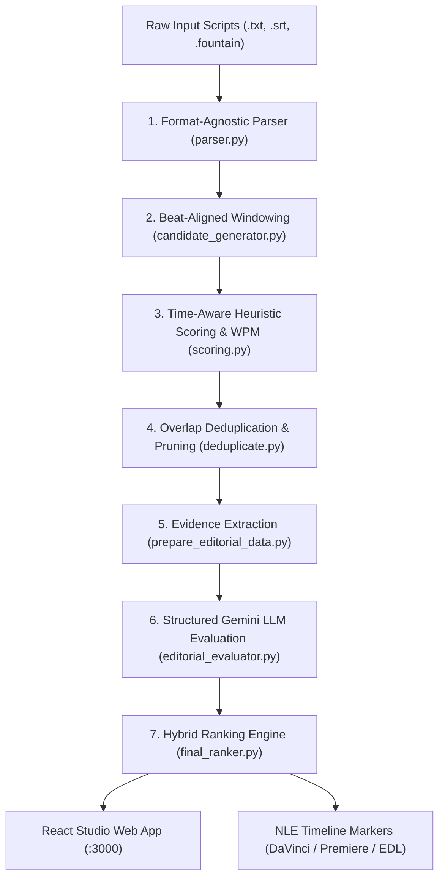

# Kuku Promo Discovery Studio — System Architecture & Technical Report

## 1. Executive Summary & Objective

The **Kuku Promo Discovery System** is an AI-assisted editorial intelligence engine and interactive review studio built to identify, evaluate, and rank **20–60 second promo clip windows** from timestamped microdrama screenplays and subtitle tracks.

In short-form vertical fiction platforms (microdramas), promo clips are the primary user acquisition engine across TikTok, Instagram Reels, YouTube Shorts, and in-app paywalls. A high-converting promo requires:
1. **Instant Hook (0–3s):** Grabs mobile scrollers immediately before they swipe away.
2. **Rising Conflict & Pacing:** Rapid dialogue turnover and high emotional stakes without dead air.
3. **Unresolved Cliffhanger (Final 5s):** Cuts abruptly at peak tension without revealing the resolution, compelling viewers to click through to the full episode.
4. **Self-Contained Stakes:** Understandable to new viewers who have never watched prior episodes.

---

## 2. End-to-End Discovery Pipeline



---

## 3. Algorithmic Innovations & Mechanics

### A. Beat-Aligned Windowing (`candidate_generator.py`)
* **Problem with Naive Sliding Windows:** Stepping at arbitrary intervals (`start += 5s`) caused **217 event boundary crossings**, frequently slicing in the middle of an actor's spoken sentence or midway through a physical punch.
* **Beat-Aligned Solution:** Promos start strictly at an event's start timestamp ($t = e_i.\text{start}$) and conclude strictly at an event's completion ($t = e_j.\text{end}$), with total duration constrained strictly between 20.0s and 60.0s:
  $$\text{duration} = e_j.\text{end} - e_i.\text{start} \in [20.0, 60.0]$$
* **Result:** Clean dialogue delivery and eliminated sentence truncation.

### B. Time-Aware Heuristic Scoring (`scoring.py`)
* **Fixing Character Slicing:** Naive heuristics evaluate character lengths (`text[:350]`), which fail when 350 characters of quick dialogue take 18 seconds, but 350 characters of camera directions span only 2 seconds.
* **Timestamp Windows:**
  * **Hook:** Evaluates events where $e.\text{start} \le \text{clip\_start} + 3.5\text{s}$.
  * **Cliffhanger:** Evaluates events where $e.\text{end} \ge \text{clip\_end} - 5.5\text{s}$.
* **Cadence & Turnover:** Computes dialogue alternation turns and Words Per Minute:
  $$\text{WPM} = \frac{\text{Word Count}}{\text{Duration (seconds)}} \times 60$$
  * $<85\text{ WPM}$: Visual / slow dramatic delivery.
  * $85 - 165\text{ WPM}$: **Optimal vertical microdrama pace**.
  * $>165\text{ WPM}$: High-density fast dialogue.

### C. Multi-Format Screenplay Ingestion (`parser.py`)
Auto-detects and ingests:
1. **Kuku Screenplay TXT:** `EPISODE NUMBER:`, `SCENE \d+`, `Start: (mm:ss.ff) | End: (mm:ss.ff)`.
2. **SubRip Subtitles (.srt):** Subtitle blocks with millisecond timecodes (`00:01:23,456 --> 00:01:28,789`), automatically parsing speakers from captions.
3. **Fountain Screenplays (.fountain):** Industry-standard plain text scripts with estimated speech pacing.

### D. Pydantic-Validated Gemini Evaluation (`editorial_evaluator.py`)
* Evaluates 5 dimensions on a 1–10 scale:
  1. `hook_score` (subject to strict first-3s rule)
  2. `cliffhanger_score` (subject to strict final-5s rule)
  3. `emotional_score` (intensity of stakes)
  4. `standalone_score` (new-viewer comprehension)
  5. `progression_score` (narrative development)
* **Weighted Gemini Editorial Score ($0 - 100$):**
  $$\text{Score}_{\text{Gemini}} = 10 \times \left(0.25 S_{\text{hook}} + 0.25 S_{\text{cliff}} + 0.20 S_{\text{emotion}} + 0.15 S_{\text{standalone}} + 0.15 S_{\text{progression}}\right)$$
* **Final Hybrid Score:**
  $$\text{Score}_{\text{Hybrid}} = 0.70 \times \text{Score}_{\text{Gemini}} + 0.30 \times \text{Score}_{\text{Local}}$$

---

## 4. Benchmark Dataset Audit: *I Married a Broken Soldier. He was a Duke*

| Metric | Result |
|---|---:|
| Total Screenplay Episodes Audited | 50 episodes |
| Total Scenes / Timestamped Events | 100 scenes / 3,727 events |
| Generated Duration-Compliant Windows (20–60s, beat-aligned) | 53,182 windows |
| Baseline Candidates Retained | 600 candidates (12/ep) |
| Deduplicated Shortlist (overlap $\geq 0.50$ of the shorter clip pruned, max 3/ep) | **60 candidates** |
| Episodes Represented in Final Shortlist | 50 / 50 (100%) |
| Average Gemini Score | 75.73 / 100 |
| Gemini Promising Rate | 96.7% (58/60) |
| Hook/Cliffhanger Timestamp Compliance | 46 PASS, 14 PARTIAL, 0 FAIL |
| Clips 55s or longer | 18% (previously 46% with sliding windows) |

> **Note:** an earlier snapshot of this dataset used fixed 5-second sliding windows (74 candidates).
> Those outputs are archived under `outputs/archive/sliding_windows_20261107/` and are described by
> `DATASET_AUDIT.md`. The numbers above are from the current beat-aligned run
> (`outputs/runs/run_refresh_20261107/`, promoted to `outputs/`).

### Top 3 Recommended Promos:
1. **Rank #1: Episode 32 (`107.0s – 150.8s`, Duration: 43.8s)**
   * Hybrid: **78.35** | Gemini: **86.0** | Compliance: **PASS**
   * *Dynamics:* Dungeon Confrontation. Imprisoned Juliana calmly defies and psychologically dismantles Catherine, who snaps and escalates to a branding-iron threat.
2. **Rank #2: Episode 24 (`33.8s – 89.8s`, Duration: 56.0s)**
   * Hybrid: **76.65** | Gemini: **88.5** | Compliance: **PASS**
   * *Dynamics:* Servitude & Vow. Juliana is abused and forced into servitude by a cruel noblewoman, but keeps her mother's remedy journal and vows to fight back.
3. **Rank #3: Episode 45 (`42.0s – 88.2s`, Duration: 46.2s)**
   * Hybrid: **74.30** | Gemini: **86.0** | Compliance: **PASS**
   * *Dynamics:* Public Reckoning. Alexander exposes Catherine's crimes and declares Juliana his true wife, then the Crown and a Bishop abruptly interrupt.

---|---:|
| Total Screenplay Episodes Audited | 50 episodes |
| Total Scenes / Timestamped Events | 100 scenes / 3,727 events |
| Generated Duration-Compliant Windows (20–60s) | 7,749 windows |
| Baseline Candidates Retained | 600 candidates (12/ep) |
| Deduplicated Shortlist (overlap $\geq 0.50$ of the shorter clip pruned, max 3/ep) | **74 candidates** |
| Episodes Represented in Final Shortlist | 50 / 50 (100%) |
| Average Gemini Score | 70.57 / 100 |
| Gemini Promising Rate | 86.5% (64/74) |
| Hook/Cliffhanger Timestamp Compliance | 43 PASS, 28 PARTIAL, 3 FAIL |

### Top 3 Recommended Promos:
1. **Rank #1: Episode 16 (`0.0s – 55.0s`, Duration: 55s)**
   * Hybrid: **79.90** | Gemini: **94.0** | Compliance: **PASS**
   * *Dynamics:* Action & Betrayal Reveal. Alexander protects Juliana from 3 thugs under the moonlight, disarms them, and forces out the mastermind's name (*"Harrington! Gerald Harrington paid us!"*).
2. **Rank #2: Episode 32 (`105.0s – 150.0s`, Duration: 45s)**
   * Hybrid: **76.70** | Gemini: **83.0** | Compliance: **PASS**
   * *Dynamics:* Dungeon Confrontation. Chained Juliana verbally dismantles Catherine's ego, provoking Catherine to raise a glowing red branding iron.
3. **Rank #3: Episode 42 (`25.0s – 75.0s`, Duration: 50s)**
   * Hybrid: **75.35** | Gemini: **86.0** | Compliance: **PASS**
   * *Dynamics:* Family Betrayal. Explosive power shift as the presumed-dead Duke returns.

---

## 5. Frontend Architecture

The review studio is a single **React 18 / Vite 6 / Tailwind CSS** web app (`:3000`, in `frontend/`). It parses uploaded scripts in the browser, generates beat-aligned promo windows, optionally evaluates clips with Gemini on demand, and offers:

* A **9:16 vertical phone mockup** with autoscrolling teleprompter and Web Audio SFX.
* **Side-by-side head-to-head battle mode** for comparing clips.
* One-click DaVinci CSV, Premiere CSV and CMX 3600 EDL exports.

Batch processing of the full episode set runs through the Python pipeline in `src/` (see Section 2).

---

## 6. Video Editor NLE Integration

The system generates ready-to-import timeline assets located in [`outputs/ranked_promos/`](file:///c:/Users/Praveen%20Roj/Downloads/kuku_promo_discovery_source/kuku-promo-discovery/outputs/ranked_promos):
* `top_10_davinci_markers.csv`: Color-coded markers (Cyan for top scores, Green for baseline) for DaVinci Resolve.
* `top_10_premiere_markers.csv`: Sequence markers for Adobe Premiere Pro.
* `top_10_promos.edl`: Standard CMX 3600 sequence list for assembling a continuous highlight reel.

---

## 7. Verification & Test Suite

All unit and integration tests are automated via [`pytest`](file:///c:/Users/Praveen%20Roj/Downloads/kuku_promo_discovery_source/kuku-promo-discovery/pytest.ini) and pass cleanly:
```bash
pytest -v
```
* `test_supplied_pack_has_50_episode_files` — PASSED
* `test_all_parsed_event_timestamps_are_ordered` — PASSED
* `test_to_seconds` — PASSED
* `test_parse_episode_metadata` — PASSED
* `test_parse_srt_format` — PASSED
* `test_beat_aligned_windowing` — PASSED
* `test_time_aware_scoring` — PASSED
* `test_nle_export` — PASSED
* `test_gemini_response_schema_validation` — PASSED

Additional regression tests (43 Python tests in total via `pytest`, plus 30 frontend tests via `npm test` and a 30-step real-browser smoke test (`scripts/ui_smoke_test.py`) in `frontend/`) cover the shared hook/cliffhanger windows, dialogue-only WPM, overlap deduplication, frame-accurate EDL export, the uploaded-script parser and the Gemini batch abort/cancel logic.
